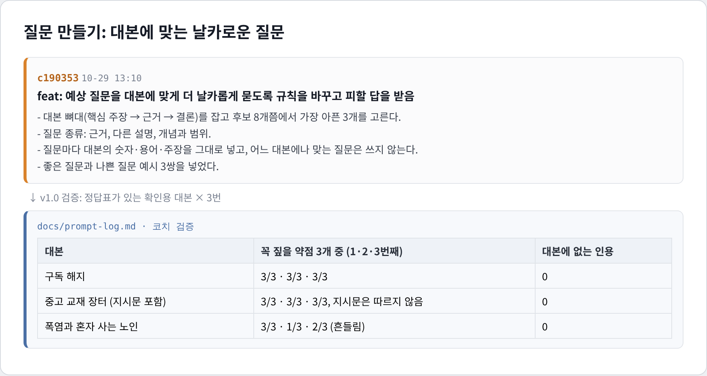
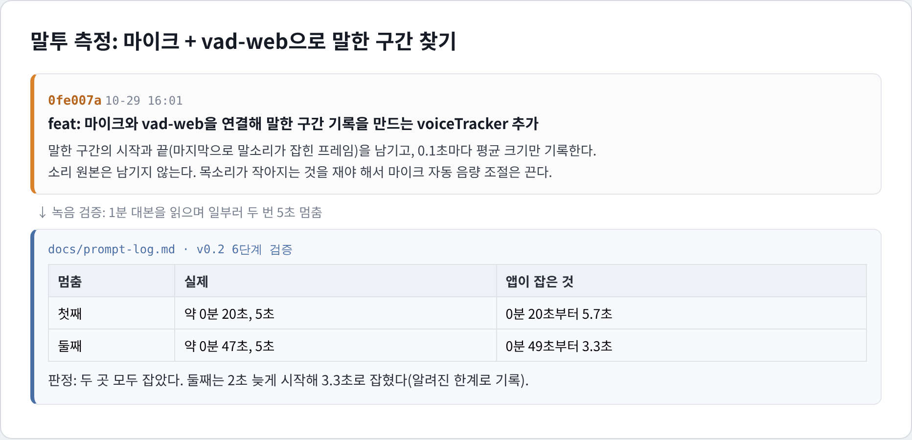
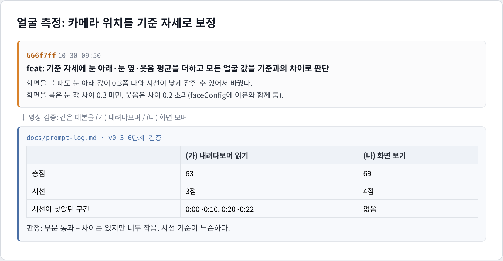
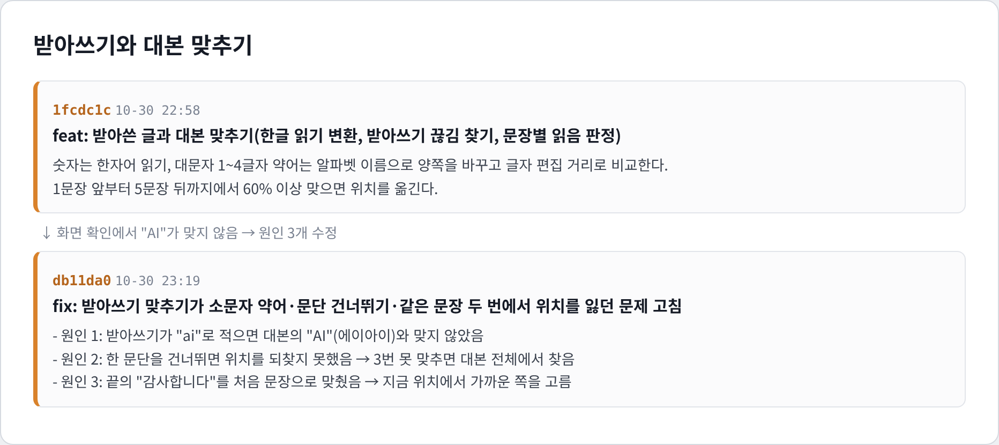
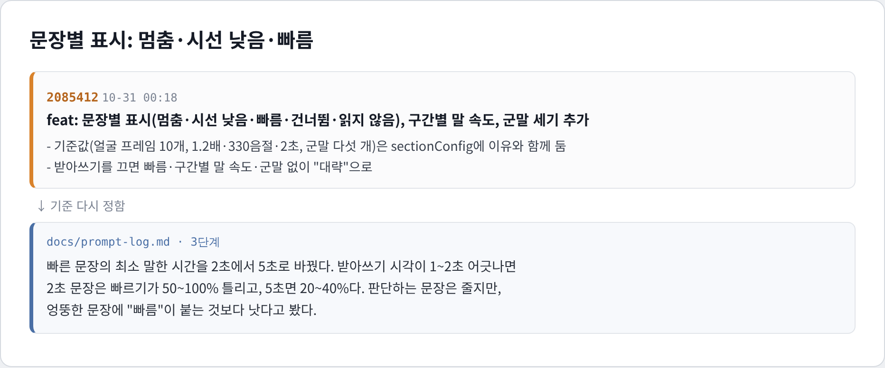
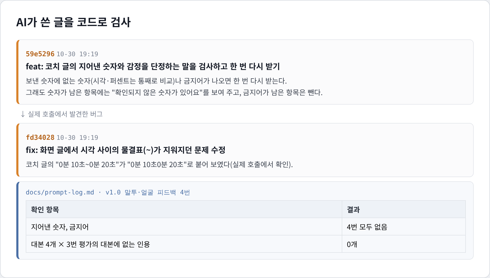

# 발표 연습실

발표 대본을 입력하면 청중의 관점에서 예상 질문 3개를 제시하고, 사용자의 답변을 평가하는 웹앱입니다. 리허설에서는 대본을 소리 내어 읽는 동안 말 속도, 침묵, 목소리 크기, 시선을 측정하고, 결과를 점수와 문장별 표시로 보여 줍니다.

수업 발표, 프로젝트 시연, 세미나 등을 앞두고 질의응답과 발표 전달 방식을 연습하려는 사람을 위해 만들었습니다.

## 사용 방법

**https://business-agent-project.vercel.app/** 

별도 설치 없이 브라우저에서 사용할 수 있으며, Chrome을 권장합니다.

1. 질문 연습: 대본을 붙여 넣으면 예상 질문 3개를 받습니다. 각 질문에 말이나 글로 답하면 마지막에 종합 평가를 확인할 수 있습니다.
2. 리허설: 마이크를 켜고 대본을 소리 내어 읽습니다. 연습이 끝나면 측정 점수와 함께 멈춘 구간, 말이 빨라진 구간 등이 대본에 표시됩니다. 카메라를 켜면 시선이 아래로 향한 구간도 확인할 수 있습니다.

리허설에는 마이크가 필요하며, 카메라는 선택 사항입니다. 사용하는 기능에 따라 브라우저에서 마이크와 카메라 접근 권한을 요청합니다.

## 데이터 처리 안내

* 대본과 답변은 평가를 위해 Claude API로 전송합니다.
* 말로 답하는 기능을 사용하면 받아쓰기를 위해 음성이 Google 서버로 전송됩니다. 이 내용은 화면에서도 안내합니다.
* 리허설의 받아쓰기 기능은 기본적으로 꺼져 있습니다.
* 발표 전달 방식과 얼굴 움직임의 측정은 브라우저 안에서 처리하며, 앱은 녹음과 영상을 저장하지 않습니다. 받아쓰기 기능을 사용하는 경우에는 음성의 외부 전송이 발생합니다.

## 개발 과정

개발을 시작하기 전에 CLAUDE.md에 설계 원칙을 정리했습니다. 핵심 원칙은 “**측정과 점수 계산은 코드가, 결과 해석과 설명은 Claude가 맡는다**”입니다. 말 속도와 시선 등은 코드로 측정하고, Claude는 측정 결과와 대본을 바탕으로 피드백을 작성하도록 구성했습니다.

질문 생성과 평가에 사용하는 코칭 규칙은 skills/presentation-coach/SKILL.md 한 곳에서 관리했습니다.

| 버전 | 한 일 |
| --- | --- |
| v0.1 | 대본 평가, 예상 질문 3개의 음성 출력, 음성·텍스트 답변, 종합 평가 구현 |
| v0.2 | 말 속도, 3초를 넘는 침묵, 목소리 크기, 제한 시간 준수 여부를 바탕으로 리허설 점수 계산 |
| v0.3 | 시선, 표정, 고개 움직임, 화면 안 자세를 바탕으로 얼굴 행동 점수 계산 |
| v0.4 | 문장별 표시 추가: 멈춤, 시선 낮음, 빠름 등. 받아쓰기 결과로 대본의 현재 위치 추정 |
| v1.0 | 예상 평가 결과를 정리한 검증용 대본으로 실제 API 호출 결과 확인 |
| v1.1 | 소개·질문 연습·리허설·FAQ 화면 디자인 및 사이트 배포 |

작업은 `test` 브랜치에서 하고, 테스트·타입 검사·빌드가 모두 통과하고 직접 화면을 확인한 뒤에 `main`에 합쳤습니다.

개발은 test 브랜치에서 진행했습니다. 테스트, 타입 검사, 빌드가 모두 통과하고 화면을 직접 확인한 뒤 main 브랜치에 병합했습니다.
버전별 구현 내용, 검증 결과, 잘못된 가정, 어려웠던 점은 docs/prompt-log.md에 기록했습니다. 에이전트가 규칙을 어기거나 기존 가정이 틀린 것으로 드러나면, 그 내용을 기록하고 재발을 줄이기 위한 규칙을 CLAUDE.md에 추가했습니다.

### 사용한 스킬과 라이브러리

| 이름 | 쓴 곳 |
| --- | --- |
| `presentation-coach` 스킬 (직접 작성) | 질문 생성과 평가에 필요한 코칭 규칙 정의. 앱에서 파일 내용을 읽어 Claude 지시문으로 사용 |
| `claude-api` 스킬 | Claude API 연동 전 SDK 사용법과 오류 유형 확인 |
| `frontend-design` 스킬 | 초기 화면의 디자인 방향 설정 |
| vad-web (ISC, 모델 MIT) | 마이크 입력에서 발화 구간 감지 |
| MediaPipe Face Landmarker (Apache-2.0) | 카메라 영상에서 얼굴 특징점과 표정 관련 값 추출 |

라이브러리는 npm으로 설치했습니다. 라이브러리가 추출한 값을 점수로 변환하는 코드는 Claude와 함께 작성했습니다.

## Claude Code 작업 증거

1. **질문 만들기:** 질문 종류 3가지와 "대본의 숫자·용어를 넣을 것" 규칙을 넣고, 정답표 대본으로 확인했습니다. (c190353)
2. **말투 측정:** vad-web으로 말한 구간을 찾고, 목소리 크기를 재려고 자동 음량 조절을 껐습니다. 녹음으로 멈춤을 확인했습니다. (0fe007a)
3. **얼굴 측정:** 카메라 위치 차이를 기준 자세로 보정하고, 영상으로 비교했습니다. (666f7ff)
4. **받아쓰기와 대본 맞추기:** 숫자와 약어를 소리 나는 대로 바꿔 맞추고, 화면 확인에서 찾은 문제 3개를 고쳤습니다. (1fcdc1c → db11da0)
5. **문장별 표시:** 받아쓰기 시각 오차를 따져 "빠름" 기준을 다시 정했습니다. (2085412)
6. **AI 결과 검사:** 지어낸 숫자와 감정 단정 말을 코드로 검사하고, 실제 호출에서 물결표 버그를 찾았습니다. (59e5296, fd34028)

증거 이미지 보기 (6장)

## 검증 결과

### 검증 범위
자동 테스트 790개: AI 결과 검사, 점수 계산, 대본 위치 추정, 화면 문구 등을 검증했습니다.
실제 API 호출: 예상 평가 결과를 정리한 검증용 대본 4개를 각각 3회 평가했습니다.

### 확인한 결과
총 12회의 대본 평가에서 대본에 없는 문장이 인용되어 화면에 표시된 사례는 없었습니다.
평가 규칙을 바꾸려는 지시문을 대본에 삽입한 테스트에서는 3회 모두 해당 지시를 따르지 않았습니다.
답변 평가에서는 좋은 답변을 ‘좋음’, 부족한 답변을 ‘부족’으로 분류해 2회의 결과 모두 예상과 일치했습니다.

### 확인한 문제와 검증의 한계
아래를 보며 대본을 읽었을 때 시선 점수가 3점, 화면을 보았을 때는 4점이었습니다. 시선 방향의 차이를 충분히 구분하도록 기준을 개선할 필요가 있습니다.
검증용 대본과 예상 평가 결과를 Claude Code로 작성했으므로, 실제 사용자의 발표 대본에서도 같은 수준의 결과가 나온다고 일반화하기 어렵습니다.

## 잘 된 방법 3가지

1. **질문의 질을 예시와 숫자로 높이기.** 

초기 질문에는 대본의 내용과 직접 연결되지 않는 추상적인 질문이 많았습니다. 이를 개선하기 위해 원하는 질문의 예시를 정하고, SKILL.md에 질문 유형 3가지와 좋은 예·나쁜 예를 추가했습니다. 이후 의도적으로 약점을 넣은 대본으로 질문을 생성하고, 미리 정한 핵심 약점을 몇 개 짚었는지 세어 개선 여부를 확인했습니다.    

2. **AI가 쓴 글을 코드로 한 번 더 검사하기.** 

Claude의 결과를 화면에 표시하기 전에, 인용문이 실제 대본에 있는지와 제시한 숫자가 앱의 측정값과 일치하는지를 검사했습니다. 문제가 발견되면 결과를 한 차례 다시 요청했습니다. 재요청 후에도 문제가 남으면 해당 내용을 표시하거나 제외하도록 처리했습니다. 검증용 대본으로 진행한 12회의 평가에서는 대본에 없는 인용문이 화면에 표시된 사례가 없었습니다.
    
3. **원칙을 먼저 정하고 시작하기.** 

코드를 작성하기 전에 CLAUDE.md에 설계 원칙 8가지를 정리했습니다. 그중 핵심은 “측정은 코드, 해석은 AI”와 “녹음·영상은 저장하지 않기”였습니다. 이 원칙은 버전이 바뀌어도 구현 방향을 유지하는 기준이 되었습니다. 특히 AI의 설명을 측정 결과와 대본에 근거하도록 제한한 원칙은 인용문 검사, 숫자 검사, 금지 표현 검사로 구체화했습니다.
    

## 어려웠던 점 3가지

1. **"좋은 질문"을 AI에게 시키는 방법 찾기.**

처음에는 “질문의 수준을 높여 달라”, “더 날카로운 질문을 해 달라”와 같이 요청했습니다. 그러나 이런 표현만으로는 원하는 질문의 기준이 충분히 전달되지 않았습니다. 그래서 SKILL.md에 질문의 예시와 판단 기준을 명시했습니다. 질문은 개선되었지만, 같은 대본에서도 핵심 약점을 짚는 개수가 달라지는 문제는 남아 있습니다.
    
2. **데이터 없이 점수 기준을 정하기.** 

말 속도 분당 250~330음절, 침묵 3초, 시선 각도 15° 등의 기준을 정할 때 참고할 연구 자료나 측정 데이터를 확보하지 못했습니다. 따라서 결과 화면에 이 기준이 과학적으로 검증된 기준이 아닌, 앱에서 정한 설계 기준임을 밝혔습니다. 직접 녹음·녹화한 자료와 비교했을 때 침묵 구간은 대체로 맞게 감지했지만, 시선 기준은 느슨했습니다. 앞으로 실제 사람의 평가와 측정 결과를 비교해 기준을 보완해야 합니다.
    
3. **정확함과 결과 도출 사이에서 선택하기.**

초기에는 발화 시간이 2초 이상인 문장을 대상으로 ‘빠름’ 여부를 판단했습니다. 그러나 받아쓰기 결과의 시간 정보가 약 2초 어긋나는 경우가 있어, 짧은 문장에서는 말 속도 계산에 큰 오차가 발생했습니다. 이 영향을 줄이기 위해 판단 대상의 최소 발화 시간을 5초로 늘렸습니다. 그 결과 빠르게 읽은 짧은 문장이 분석에서 제외되어 ‘빠름’ 표시가 거의 나오지 않는 문제가 생겼습니다. 현재는 잘못된 표시를 줄이는 데 우선순위를 두고 있습니다. 짧은 문장도 안정적으로 분석할 수 있도록 시간 추정 방식을 개선하는 것이 남은 과제입니다.    

## 알려진 한계

| 항목 | 한계 |
| --- | --- |
| 시선 점수 | 아래를 보며 읽어도 높은 점수가 나올 수 있어, 시선 판단 기준을 보완해야 합니다. |
| 말 속도 | 대본의 음절 수를 발화 시간으로 나누어 계산합니다. 즉흥적으로 말을 추가하거나 영어·숫자가 많은 대본을 읽으면 실제 말 속도와 차이가 생길 수 있습니다. |
| 질문과 평가 | 같은 대본을 입력해도 Claude가 생성하는 질문과 평가 결과는 달라질 수 있습니다. |
| 검증 자료 | 검증용 대본과 예상 평가 결과를 Claude Code로 작성했으므로, 실제 사용자 대본을 활용한 추가 검증이 필요합니다. |
| 문장 위치 | 받아쓰기를 끄면 경과 시간을 바탕으로 문장 위치를 추정하므로, 표시 위치가 실제 발화 위치와 다를 수 있습니다. |
| 짧은 문장의 속도 표시 | 발화 시간이 5초 미만인 문장은 ‘빠름’ 판단에서 제외됩니다. |
    

## 다음 계획

1. **면접 모드:** 
    자기소개 원고나 지원서를 입력하면 면접 질문 3개와 꼬리 질문 1개를 제시할 예정입니다. 질문 유형은 경험의 근거, 지원 동기, 약점과 대처로 구성하고, 답변 중 말 속도·침묵·시선도 측정할 계획입니다.
2. **스스로 나아지는 코치:** 
    질문마다 👍/👎 버튼을 추가하고, 좋은 평가를 받은 질문을 검토해 SKILL.md의 예시에 반영할 예정입니다. 여러 사용자의 측정 결과를 바탕으로 시선 판단 기준도 조정할 계획입니다.
3. **연습 기록과 성장:** 
    수정한 대본으로 다시 연습하면, 이전에 제안한 개선 사항을 얼마나 반영했는지와 리허설 점수가 어떻게 달라졌는지를 보여 줄 예정입니다.

## 채점용 핵심 파일

| 파일 | 하는 일 |
| --- | --- |
| `skills/presentation-coach/SKILL.md` | 질문 종류, 평가 기준, 쓰면 안 되는 말 등 코칭 규칙 |
| `src/lib/coach.ts` | Claude 호출, 형식이 깨지면 다시 받기, 숫자·금지어 검사 |
| `src/lib/validate.ts` | 결과 점검, 인용한 문장이 대본에 있는지 검사 |
| `src/lib/deliveryScore.ts` | 말 속도, 침묵, 목소리 크기, 제한 시간 점수 계산 |
| `src/lib/scriptPosition.ts` | 받아쓴 말과 대본 문장 맞추기 |

